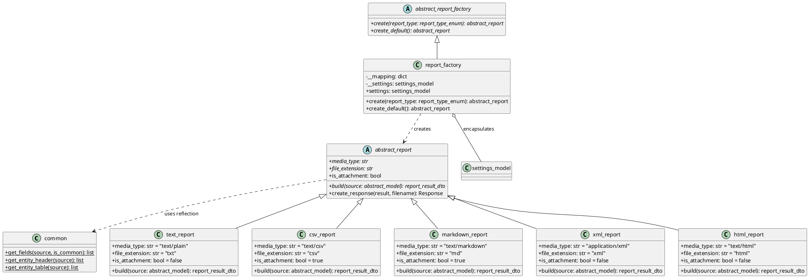
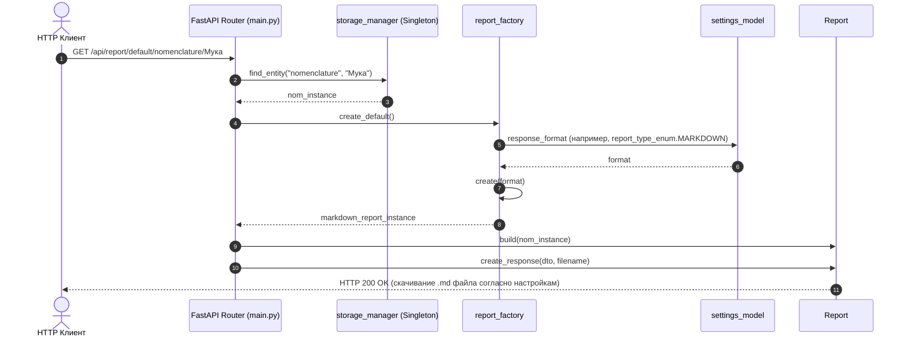

# UML диаграммы для моделей данных, менеджеров и фабрики отчетов

В данном документе представлены UML-диаграммы классов и последовательностей, описывающие архитектуру приложения, доменных моделей (технологические карты/рецепты, полуфабрикаты, тара, фабричные методы), менеджеров настроек и хранилища данных, а также подсистемы формирования отчетов (паттерн Factory Method, форматы CSV, Markdown, XML, HTML, TXT, рефлексия метаданных через `common`, полиморфный REST API).

---

## 1. Диаграмма классов (Class Diagram)

### 1.1. Mermaid

```mermaid
classDiagram
    class abstract_model {
        <<abstract>>
        -str __unique_code
        +unique_code() str
        +__eq__(value) bool
    }

    class entity_model {
        -str __name
        -int __max_len_name
        +name() str
    }

    class group_model {
        +__init__(name: str)
        +create(name: str)$ group_model
    }

    class range_model {
        -range_model __base
        -float __conversion_factor
        +base() range_model
        +conversion_factor() float
        +create(name: str, conversion_factor: float, base: range_model)$ range_model
        +create_gram()$ range_model
        +create_kilogram(base: range_model)$ range_model
        +create_piece()$ range_model
        +create_milliliter()$ range_model
    }

    class warehouse_model {
        -str __address
        -int __max_len_address
        +address() str
        +create(name: str, address: str)$ warehouse_model
    }

    class nomenclature_model {
        -str __full_name
        -int __full_name_max_length
        -group_model __group
        -range_model __range
        +__init__() void
        +full_name() str
        +group() group_model
        +range() range_model
        +create(name: str, full_name: str, group: group_model, range: range_model)$ nomenclature_model
    }

    class recipe_row_model {
        -nomenclature_model __nomenclature
        -receipt_model __sub_recipe
        -range_model __range
        -float __gross_weight
        -float __net_weight
        +nomenclature() nomenclature_model
        +sub_recipe() receipt_model
        +recipe() receipt_model
        +range() range_model
        +gross_weight() float
        +net_weight() float
        +brutto() float
        +netto() float
        +name() str
        +create(item, range, gross_weight, net_weight)$ recipe_row_model
    }

    class receipt_model {
        -nomenclature_model __dish
        -list __rows
        -str __comments
        +dish() nomenclature_model
        +comments() str
        +rows() list
        +items() list
        +gross_weight() float
        +net_weight() float
        +add_row(row: recipe_row_model) bool
        +remove_row(row: recipe_row_model) bool
        +create(name: str, dish: nomenclature_model, rows: list, comments: str)$ receipt_model
    }

    class common {
        +get_fields(source, is_common: bool)$ list
        +get_entity_header(source: abstract_model)$ list~entity_description_header_dto~
        +get_entity_table(source: abstract_model)$ list~entity_description_table_dto~
    }

    class entity_description_header_dto {
        -str __field
        -str __value
        +field() str
        +value() str
    }

    class entity_description_table_dto {
        -list __columns
        -list __values
        +columns() list
        +values() list
    }

    class abstract_manager {
        <<abstract>>
        #str _file_name
        #bool _is_loaded
        #dict _data
        +load(file_name: str) void
        +convert() bool*
        +is_loaded() bool
    }

    class settings_manager {
        -settings_manager _instance$
        -bool _initialized$
        -str __default_file_name
        -settings_model _settings
        +__new__() settings_manager
        +load(file_name: str) void
        +convert() bool
        +settings() settings_model
        +data() dict
    }

    class settings_model {
        -organization_model __organization
        -str __boss_name
        -str __account_name
        -bool __first_launch_flag
        -report_type_enum __response_format
        +organization() organization_model
        +boss_name() str
        +account_name() str
        +first_launch_flag() bool
        +response_format() report_type_enum
    }

    class storage_manager {
        -storage_manager _instance$
        -bool _initialized$
        -list _groups
        -list _ranges
        -list _nomenclatures
        -list _warehouses
        -list _recipes
        +__new__() storage_manager
        +load(file_name: str) void
        +convert() bool
        +first_start(file_name: str) bool
        +add_warehouse(item: warehouse_model) bool
        +add_range(item: range_model) bool
        +add_group(item: group_model) bool
        +add_nomenclature(item: nomenclature_model) bool
        +add_recipe(item: receipt_model) bool
        +find_entity(entity_type: str, code: str) abstract_model
        +warehouses() list
        +ranges() list
        +units() list
        +groups() list
        +nomenclatures() list
        +recipes() list
    }

    class report_type_enum {
        <<enumeration>>
        TXT
        CSV
        MARKDOWN
        XML
        HTML
        +from_string(value: str)$ report_type_enum
    }

    class report_result_dto {
        -str __text
        -list __binary
        -str __format
        +text() str
        +binary() list
        +format() str
    }

    class abstract_report {
        <<abstract>>
        +build(source: abstract_model)* report_result_dto
        +media_type()* str
        +file_extension()* str
        +is_attachment() bool
        +create_response(result, filename_prefix) Response
    }

    class text_report {
        +media_type() str
        +file_extension() str
        +is_attachment() bool
        +build(source: abstract_model) report_result_dto
    }

    class csv_report {
        +media_type() str
        +file_extension() str
        +is_attachment() bool
        +build(source: abstract_model) report_result_dto
    }

    class markdown_report {
        +media_type() str
        +file_extension() str
        +is_attachment() bool
        +build(source: abstract_model) report_result_dto
    }

    class xml_report {
        +media_type() str
        +file_extension() str
        +is_attachment() bool
        +build(source: abstract_model) report_result_dto
    }

    class html_report {
        +media_type() str
        +file_extension() str
        +is_attachment() bool
        +build(source: abstract_model) report_result_dto
    }

    class abstract_report_factory {
        <<abstract>>
        +create(report_type: report_type_enum)* abstract_report
        +create_default()* abstract_report
    }

    class report_factory {
        -dict __mapping
        -settings_model __settings
        +create(report_type: report_type_enum) abstract_report
        +create_default() abstract_report
        +settings() settings_model
    }

    abstract_model <|-- entity_model
    abstract_model <|-- recipe_row_model
    abstract_model <|-- settings_model
    entity_model <|-- warehouse_model
    entity_model <|-- range_model
    entity_model <|-- group_model
    entity_model <|-- nomenclature_model
    entity_model <|-- receipt_model
    entity_model <|-- report_result_dto

    abstract_manager <|-- settings_manager
    abstract_manager <|-- storage_manager

    abstract_report <|-- text_report
    abstract_report <|-- csv_report
    abstract_report <|-- markdown_report
    abstract_report <|-- xml_report
    abstract_report <|-- html_report

    abstract_report_factory <|-- report_factory

    report_factory o-- settings_model : Инкапсулирует настройки
    report_factory ..> abstract_report : Создает
    report_factory ..> report_type_enum : Использует
    abstract_report ..> report_result_dto : Формирует
    abstract_report ..> common : Извлекает метаданные моделей
    common ..> entity_description_header_dto : Формирует заголовки
    common ..> entity_description_table_dto : Формирует таблицы

    storage_manager ..> settings_manager : Singleton call
    storage_manager o-- "0..*" warehouse_model : Хранит
    storage_manager o-- "0..*" range_model : Хранит
    storage_manager o-- "0..*" group_model : Хранит
    storage_manager o-- "0..*" nomenclature_model : Хранит
    storage_manager o-- "0..*" receipt_model : Хранит

    nomenclature_model --> group_model : Группа
    nomenclature_model --> range_model : Ед. изм.
    range_model --> range_model : Базовая единица

    receipt_model *-- "1..*" recipe_row_model : Состав
    receipt_model --> nomenclature_model : Выходное блюдо/полуфабрикат
    recipe_row_model --> nomenclature_model : Номенклатура / тара
    recipe_row_model --> "0..1" receipt_model : Вложенный рецепт (блюдо в блюде)
    recipe_row_model --> range_model : Ед. изм.
```



### 1.2. PlantUML



---

## 2. Диаграмма последовательности: Универсальное построение отчета через `common`

```mermaid
sequenceDiagram
    autonumber
    actor Client as HTTP Клиент (Браузер / cURL)
    participant API as FastAPI Router (main.py)
    participant Storage as storage_manager (Singleton)
    participant Factory as report_factory
    participant Report as Построитель отчета (csv / md / xml / html / txt)
    participant Common as Сервис рефлексии (common)
    participant Result as report_result_dto

    Client->>API: GET /api/report/receipt/Песочное тесто?format=CSV
    API->>Storage: find_entity("receipt", "Песочное тесто")
    Storage-->>API: receipt_instance
    API->>Factory: create(report_type_enum.CSV)
    Factory-->>API: csv_report_instance
    API->>Report: build(receipt_instance)
    Note over Report,Common: Универсальное извлечение данных без if isinstance
    Report->>Common: get_entity_header(receipt_instance)
    Common-->>Report: headers (field, value)
    Report->>Common: get_entity_table(receipt_instance)
    Common-->>Report: table_data (columns, values)
    Report->>Result: report_result_dto (binary=[...], format="text/csv")
    Result-->>Report: dto
    Report-->>API: dto
    API->>Report: create_response(dto, filename)
    Note over Report,API: Полиморфное создание Response без if в main.py
    Report-->>Client: HTTP 200 OK (Content-Disposition: attachment; filename="report.csv")
```

---

## 3. Диаграмма последовательности: Формирование отчета через `create_default`


