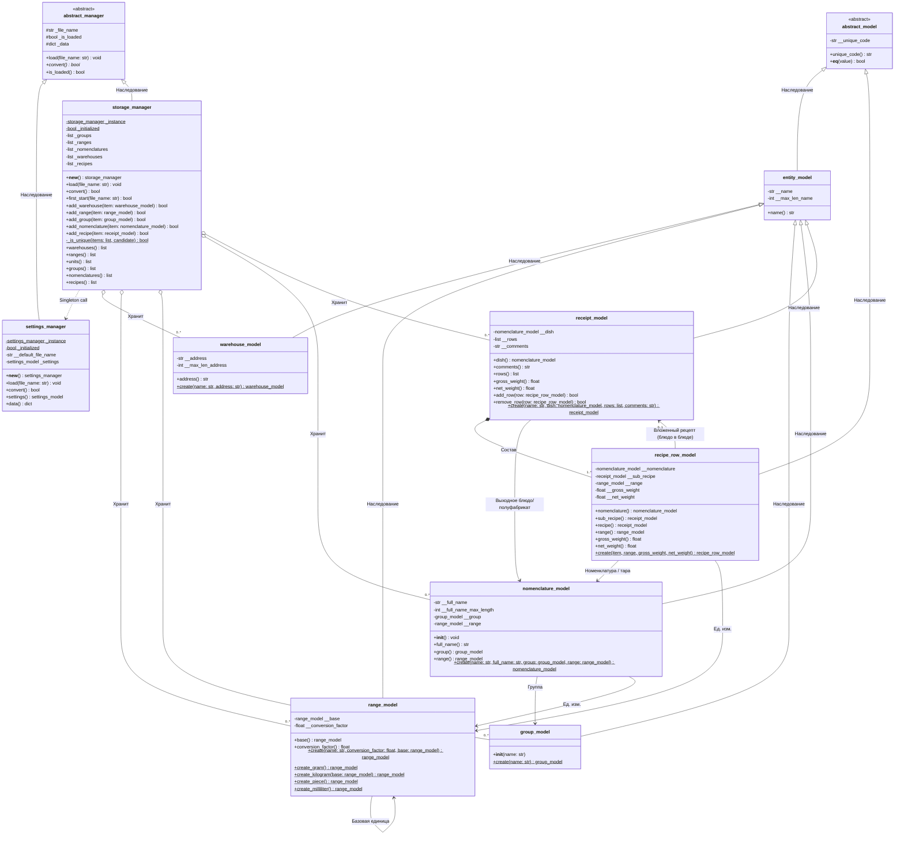
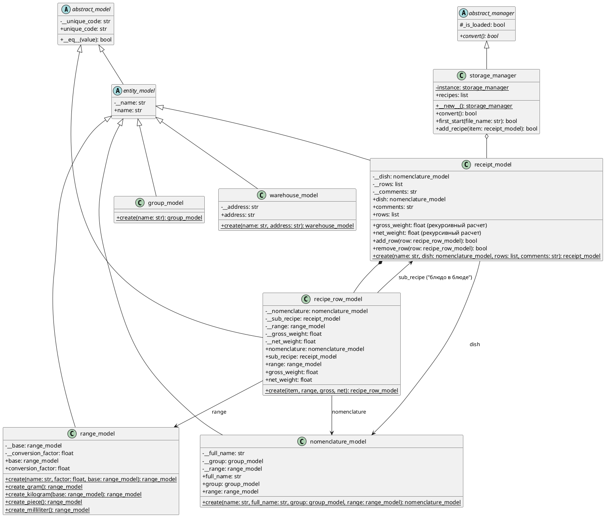
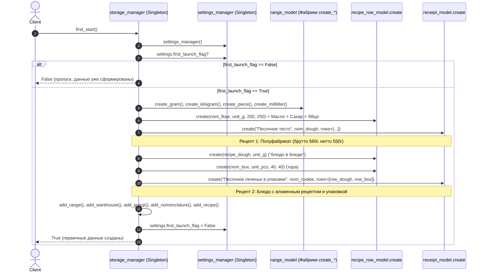
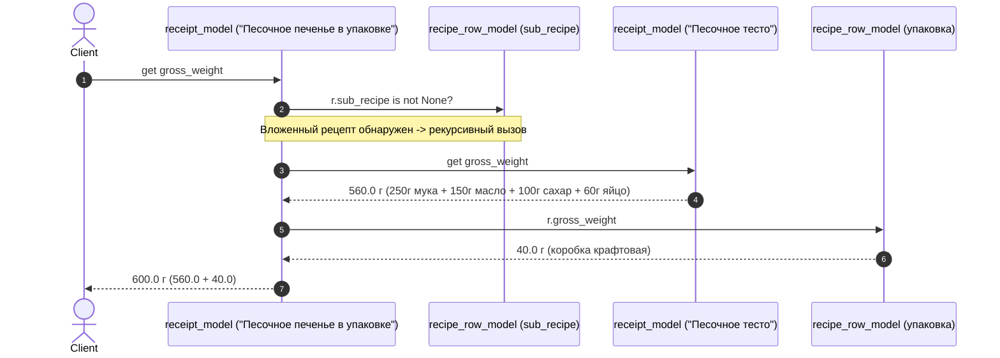

# UML диаграммы для моделей данных, `settings_manager` и `storage_manager`

В данном документе представлены UML-диаграммы классов и последовательностей, описывающие архитектуру приложения, доменных моделей (включая технологические карты/рецепты, композицию «блюдо в блюде» с рекурсивным расчетом веса, фабричные методы), а также менеджеров настроек и хранилища данных.

---

## 1. Диаграмма классов (Class Diagram)

### 1.1. Mermaid

### 1.2. PlantUML

---

## 2. Диаграмма последовательности: Первый старт («блюдо в блюде» и фабрики)

---

## 3. Диаграмма последовательности: Рекурсивный расчет веса Брутто (`gross_weight`)

